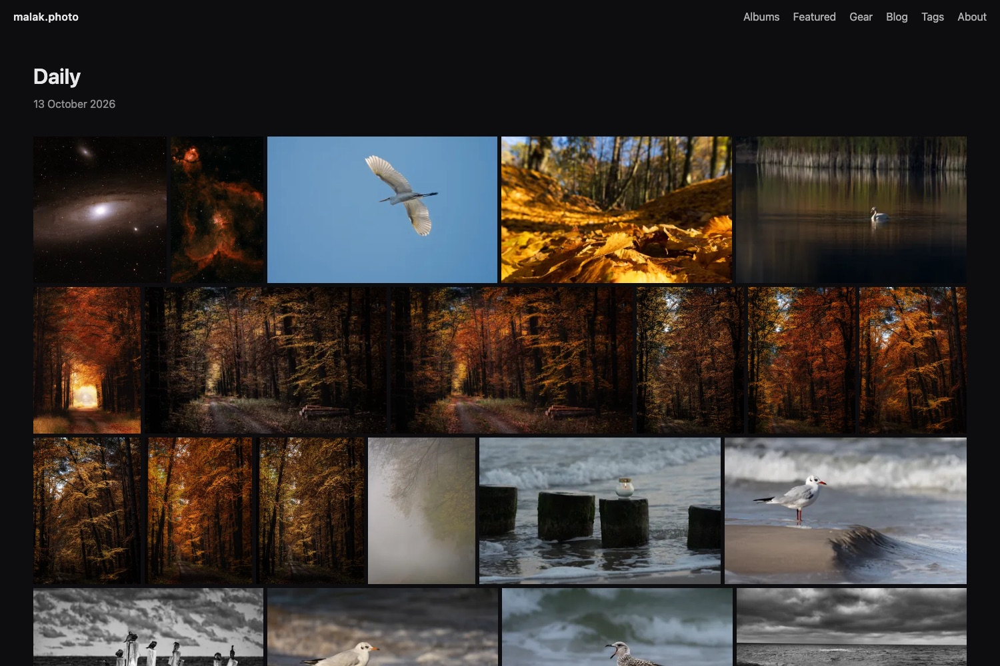
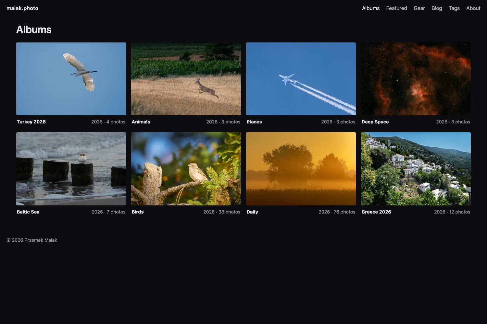
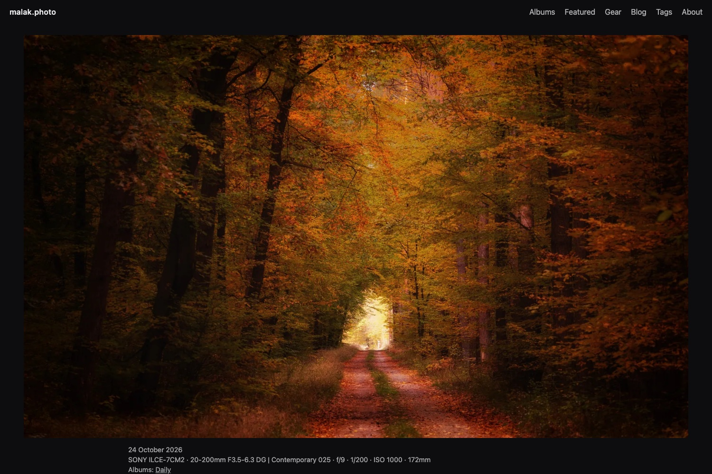
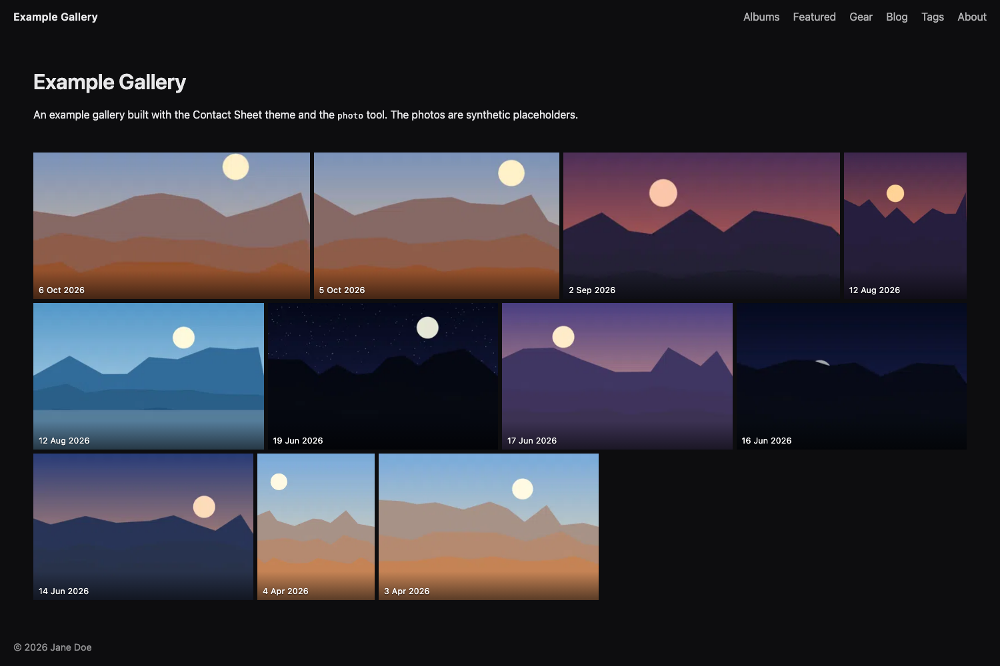
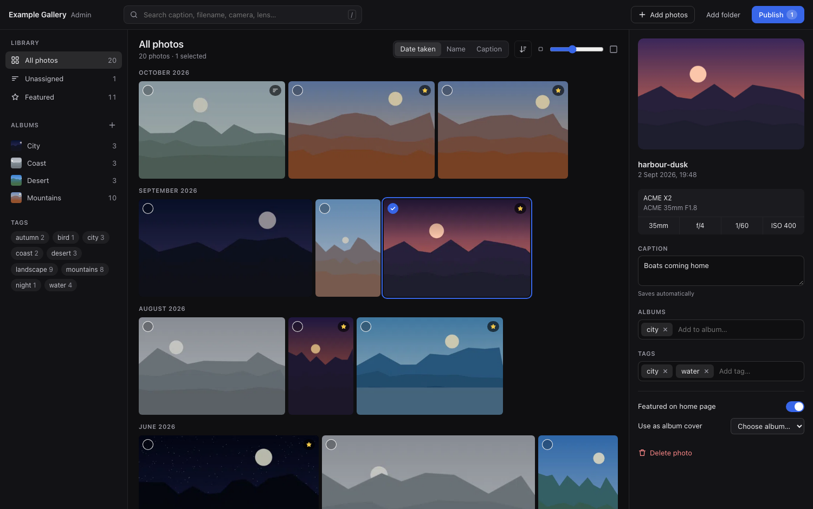

# Contact Sheet

[](https://github.com/PrzemekMalak/contact-sheet/actions/workflows/ci.yml)

A self-hosted photo portfolio and blog: a [Hugo](https://gohugo.io/) theme, a small Go
CLI/GUI (`photo`) that manages the photo catalog, and optional AWS infrastructure
(S3 + CloudFront for full-resolution originals, Amplify for the built site).



See it live at [malak.photo](https://malak.photo), the site this project was built for.

- Justified photo grids and a [PhotoSwipe](https://photoswipe.com/) lightbox
- Albums (a photo can be in several), tags, featured photos, a virtual *Unassigned* album
- Browse by gear: pages per camera, lens and camera + lens combination, from EXIF, with
  readable names you can change
- A page per photo (`/p/<id>/`) with Open Graph tags and a stable 1600px JPG link
- A blog with `photo` and `album` shortcodes
- `photo gui`: a local web panel to add, tag, caption, sort into albums and publish
  ([guide](docs/gui.md))

**Who it's for:** photographers who want their own site on their own domain instead of
Flickr, 500px or Instagram. You keep the files, the site is static, and hosting costs
little or nothing. It's meant to be used as is: you install the `photo` tool, create a site,
and get theme updates like any other dependency. Fork it only if you want to change the
theme or the tool themselves.

**What it isn't:** there are no private or password-protected albums (everything you publish
is public), and no comments, accounts or online editor. You manage photos on your computer
and publish with git.

## Screenshots

| Albums | A photo page with EXIF |
|---|---|
|  |  |

The bundled example site with synthetic placeholder photos:



## What's in this repository

```
layouts/, assets/, content/, static/   # the Hugo theme (this repo root is the theme)
hugo.toml, theme.toml, go.mod          # theme metadata and module definition
exampleSite/                           # a small demo site using the theme
tool/                                  # the `photo` CLI + GUI (Go)
infra/                                 # AWS CDK app: S3 + CloudFront + IAM + Amplify
tests/                                 # Hugo page tests (Python)
docs/                                  # guides and screenshots (own go.mod keeps them out of the theme module)
```

## Requirements

- **The `photo` tool**: a single ready-to-run program, downloaded from
  [Releases](https://github.com/PrzemekMalak/contact-sheet/releases/latest) (below).
- **[Hugo extended](https://gohugo.io/installation/) 0.166.0 or newer**: `brew install hugo`
  on macOS, `winget install Hugo.Hugo.Extended` on Windows, or your Linux package manager.
  0.166.0 is the version CI tests and the theme's declared minimum. Older versions are
  untested: Hugo warns that the theme needs a newer version, and the build may fail.

No Go, no Node, no git submodules.

## Quick start

**1. Get `photo`.** Download the archive for your system, unpack it, and put `photo` (or
`photo.exe`) somewhere on your `PATH`:

| System | Download |
|---|---|
| macOS (Apple silicon) | [photo_darwin_arm64.tar.gz](https://github.com/PrzemekMalak/contact-sheet/releases/latest/download/photo_darwin_arm64.tar.gz) |
| macOS (Intel) | [photo_darwin_amd64.tar.gz](https://github.com/PrzemekMalak/contact-sheet/releases/latest/download/photo_darwin_amd64.tar.gz) |
| Windows | [photo_windows_amd64.zip](https://github.com/PrzemekMalak/contact-sheet/releases/latest/download/photo_windows_amd64.zip) (ARM: [arm64](https://github.com/PrzemekMalak/contact-sheet/releases/latest/download/photo_windows_arm64.zip)) |
| Linux | [photo_linux_amd64.tar.gz](https://github.com/PrzemekMalak/contact-sheet/releases/latest/download/photo_linux_amd64.tar.gz) (ARM: [arm64](https://github.com/PrzemekMalak/contact-sheet/releases/latest/download/photo_linux_arm64.tar.gz)) |

The binaries aren't signed, so the system warns the first time you run one:

- **macOS** blocks it ("cannot be opened because the developer cannot be verified").
  Remove the "downloaded from the internet" mark once, in the folder where `photo` is:

  ```bash
  xattr -d com.apple.quarantine ./photo
  ```

  Or without the terminal: run `photo` once, then open System Settings → Privacy &
  Security, click **Open Anyway** next to the message about `photo`, and run it again.
- **Windows** SmartScreen may show "Windows protected your PC". Click **More info**, then
  **Run anyway**.
- **Linux** needs nothing extra. If the file lost its executable bit, run `chmod +x photo`.

Check it works with `photo version`.

**2. Create a site and add photos:**

```bash
photo init my-photos && cd my-photos
photo add ~/Pictures/iceland -a iceland --featured
hugo server        # http://localhost:1313
```

`photo init` creates the site and downloads the theme into `themes/contact-sheet/`. Run
`photo` from the site's root (the folder with `contact-sheet.toml`); every command except
`init` reads its settings there. Your repository holds only these:

```
hugo.toml            # title, URL, author, menu; names the theme
contact-sheet.toml   # photo tool settings: image sizes, optional S3 bucket
themes/contact-sheet # the theme (downloaded by photo; commit it with your site)
content/             # homepage intro, about page, blog posts, album pages
data/photos.json     # the photo catalog (written by `photo`)
assets/gallery/      # thumbnails and previews (written by `photo`)
```

`git init`, commit, and host it anywhere that runs Hugo. `photo init` options: `--title`,
`--url`, `--author`, and `--amplify` for an AWS Amplify build file.

**Updating:** `photo theme update` replaces `themes/contact-sheet/` with the latest theme
release (`--version v0.3.4` for a specific one). To change a template or the CSS, copy the
file from this repo into the same path in your site (e.g. `layouts/partials/footer.html`,
`assets/css/main.css`). Your copy takes precedence, and updates don't touch it.

### With Go: `go install` and Hugo Modules

If you have [Go](https://go.dev/dl/) 1.21 or newer, you can skip the download and use the
theme as a [Hugo Module](https://gohugo.io/hugo-modules/) instead of a copy. The tool needs
Go 1.27; if yours is older, `go install` downloads Go 1.27 for this build by itself, with no
extra steps, and leaves your installed Go unchanged:

```bash
go install github.com/PrzemekMalak/contact-sheet/tool/cmd/photo@latest
photo init my-photos --module
```

For a specific release, use its version instead of `latest`, e.g. `@v0.3.4`.

The site then has a `go.mod` instead of `themes/`, Hugo downloads the theme on the first
build, and `hugo mod get -u` updates it. Hugo needs Go for every build, including on your
host (`--amplify` adds that to `amplify.yml`).

### See the demo

```bash
git clone https://github.com/PrzemekMalak/contact-sheet.git
cd contact-sheet/exampleSite && hugo server
```

Keep the folder name `contact-sheet`: `exampleSite/hugo.toml` finds the theme two levels
up (`themesDir = "../.."`), by that name. The example photos are synthetic placeholders.

### Configuration

**`hugo.toml`** (the site)

- `baseURL`: your site's address, e.g. `https://photos.example.com/`
- `title`: the site name in the header and browser tab (also shown in `photo gui`)
- `params.author`: the name in the footer's copyright line
- `params.description`: the default description for search engines and link previews
- `params.homeMode`: what the homepage shows, `"featured"` photos or one album (`"album"`)
- `params.homeAlbum`: that album's slug, when `homeMode = "album"`
- `[menu]`: the navigation links

**`contact-sheet.toml`** (the `photo` tool)

- `[images]`: thumbnail and preview sizes in pixels, WebP quality
- `[s3]`: where originals go. Leave `bucket` empty for local mode (see below)

**`content/`** (your pages)

- `_index.md`: the homepage intro text
- `about.md`: the About page
- `blog/<post>.md`: blog posts
- `albums/<slug>/index.md`: an album's title, date and cover (created by `photo add`)

The theme provides the section pages (Albums, Featured, Gear, Tags, Blog, Unassigned) and
the per-photo pages. To change one, add a file at the same path in your site's `content/`.

### Where photos live

- **Thumbnails and previews** (WebP, ~400px and ~1600px) are generated into your site's
  `assets/gallery/` and committed with it. They're small, so the repo stays light.
- **Full-resolution originals** go to a private S3 bucket and are served through CloudFront
  (e.g. `cdn.example.com`). They're never committed.
- `data/photos.json` is the catalog: every photo with its albums, tags, caption and EXIF.
  The `photo` tool maintains it; the theme reads it.

### Local mode or originals in S3

**Local mode** (the default, `bucket = ""`): nothing is uploaded. The lightbox and the
"Full size" link show the 1600px preview. That's enough for many sites, and you can host
the result anywhere.

**Originals in S3**, for full-resolution downloads served from your own CDN. This part
assumes you're comfortable with AWS: you'll deploy a CloudFormation stack, create an IAM
access key and copy a few values by hand.

1. Deploy the originals stack from [`infra/`](infra/). It's a one-time AWS CDK deploy
   that you run with `photo cdk` from your site, so the stack settings live in your site's
   `contact-sheet.toml`. Clone this repo once for the infrastructure code:
   ```bash
   git clone https://github.com/PrzemekMalak/contact-sheet.git
   cd contact-sheet/infra
   python3 -m venv .venv && .venv/bin/pip install -r requirements.txt
   ```
   Then point your site at it, in `contact-sheet.toml`:
   ```toml
   [cdk]
   infra = "../contact-sheet/infra"   # path to the clone's infra/
   ```
   and deploy from your site's root:
   ```bash
   photo cdk bootstrap aws://<ACCOUNT_ID>/us-east-1   # once per account; the stacks are in us-east-1
   photo cdk deploy PhotoSiteStack
   ```
   [infra/README.md](infra/README.md) covers the other settings (a custom CDN domain, a
   cost alert, hosting on Amplify).
2. Create an access key for the upload user and save it as an AWS profile:
   `aws iam create-access-key --user-name photo-uploader`, then add it to
   `~/.aws/credentials` under e.g. `[photos]`.
3. Fill `[s3]` in `contact-sheet.toml` from the stack outputs: `bucket` = `BucketName`,
   `cdn_base` = `https://<DistributionDomainName>` (or your CDN domain),
   `region = "us-east-1"`, `profile = "photos"`.

From then on, `photo add` uploads each original and the site links to it on the CDN.

Choose early: photos added in local mode are not uploaded when you switch later. Adding
the same file again only adds albums. To upload one, `photo rm <id>` and add it again;
its tags, caption and albums have to be set again.

## The `photo` tool

One program with a CLI and a local management GUI, for macOS, Windows and Linux (see
Quick start). It has no dependencies: WebP encoding and EXIF reading are built in. Run it
from your site's root, next to `contact-sheet.toml`.
`photo <command> -h` prints a command's options, and **[docs/cli.md](docs/cli.md)** is the
full reference for every command and for `contact-sheet.toml`.

```bash
photo init <dir> [--title T] [--url URL] [--author A] [--amplify] [--module]
photo theme update [--version vX.Y.Z]   # replace themes/contact-sheet with a release
photo version

# Add photos (files and/or directories; -r to recurse). Repeat -a for several albums;
# omit -a and the photos land in Unassigned until you link them.
photo add <paths...> [-a <album>]... [--tags a,b] [--featured] [--no-exif] [-r]

photo link <album> <id...>      # add photos to an album
photo unlink <album> <id...>    # remove photos from one album (files kept)
photo retag <id> --tags a,b     # replace a photo's tags
photo rm <id...> [--yes]        # delete photos entirely
photo rm-album <album> [--purge-orphans] [--yes]
photo sync                      # re-sort photos.json, rebuild tag and gear pages
photo backup <dir> [--jobs N]   # copy every photo's original from the CDN to a local folder
photo gui [--port N]            # local panel at http://127.0.0.1:8765
photo cdk <diff|deploy STACK|...>   # run the AWS CDK app with [cdk] settings (infra/README.md)
```

Photo ids come from the file name (`IMG 001.jpg` becomes `img-001`). `add` creates the
derivatives, reads EXIF, uploads the original (when a bucket is set), updates
`data/photos.json`, and creates album, tag and gear pages as needed.

**Gear names.** Each camera and lens gets a page at `content/gear/<slug>/index.md`. The
tool cleans up camera names from EXIF once (`NIKON CORPORATION NIKON Z 8` becomes
`Nikon Z 8`). To show a different name, for example a model name instead of a model code,
edit `title` in that file (`title: "Sony A7 V"`). The tool never overwrites a title you
changed, and setups (camera + lens) are named after both titles. URLs don't change.

**Deleting is staged.** Everything except the S3 original is a file in your git working tree,
so it can be undone until you commit. In the GUI, deleting a photo queues the S3 delete, and
the original is deleted only by a **Publish** at least a week after the one that published
the change, so the live site keeps working while it rebuilds or if you roll it back. A photo
you restore with git within that week keeps its original. The CLI `rm` / `rm-album` delete
immediately.

**Limitations:** captions and the featured flag are edited in the GUI (the CLI sets
`--featured` only at `add` time). Two files with the same name map to the same photo id.

### The photo manager (`photo gui`)

`photo gui` opens a local web panel for day-to-day work: drag photos or whole folders in,
sort them into albums by dragging, rename and delete albums, edit captions, tags and the
featured flag, delete photos, and publish with one button. Backups are command-line only
(`photo backup`). See the **[photo manager guide](docs/gui.md)**.



### Typical workflow

```bash
photo add ~/Pictures/iceland -a iceland --tags landscape   # 1. import
$EDITOR content/albums/iceland/index.md                    # 2. optional: album title, cover
hugo server                                                # 3. preview
git add assets/gallery data content && git commit -m "album: iceland" && git push
```

Or do the same from `photo gui`.

## Hosting on AWS

Optional, and meant for people who already use AWS: the steps involve the CDK, IAM access
keys, Secrets Manager and DNS records.

[`infra/`](infra/) is an AWS CDK app with two stacks: a private S3 bucket for originals
behind CloudFront (optionally on your own domain) with a least-privilege upload user, and an
Amplify app that builds the site from GitHub on every push. See
[infra/README.md](infra/README.md) for the deployment runbook.

Any static host works for the site itself. Run `hugo --minify --gc` and publish `public/`.

## Development

```bash
cd tool && go test ./...                 # includes an end-to-end test that runs hugo
python3 -m venv .venv && .venv/bin/pip install -r tests/requirements.txt
.venv/bin/python -m pytest tests -q      # per-photo pages, amplify.yml template
cd infra && python3 -m venv .venv && .venv/bin/pip install -r requirements-dev.txt \
  && .venv/bin/python -m pytest -q       # CDK assertions (no AWS needed)
```

Tests build throwaway sites from `exampleSite/`'s configuration and the theme in this repo,
so they work under any clone name.

## License

[MIT](LICENSE)
