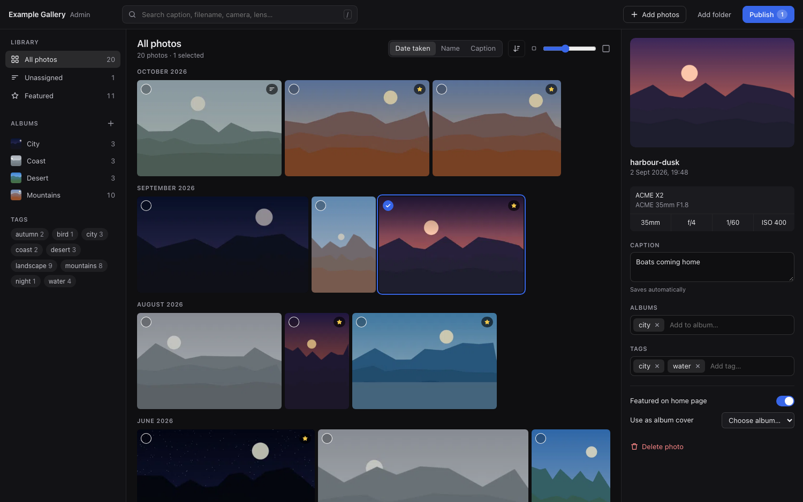
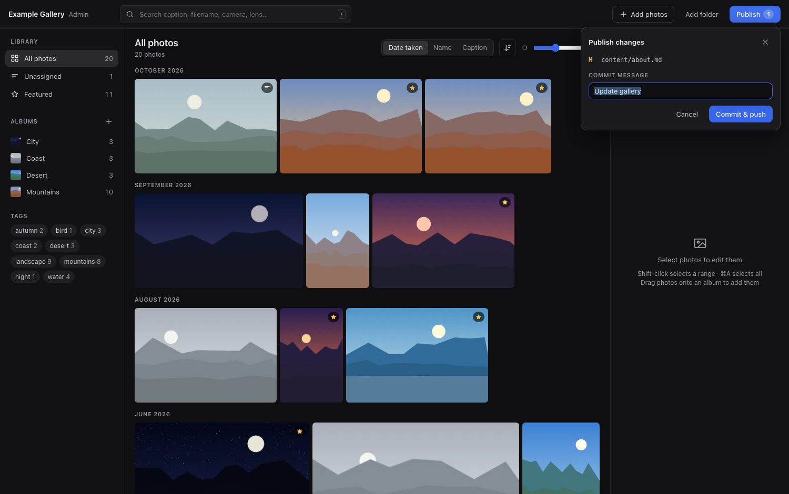

# The photo manager (`photo gui`)

`photo gui` is a local web panel for everything you'd otherwise do with `photo` commands:
add photos, sort them into albums, tag and caption them, pick featured ones, and publish.
It runs on your computer only and edits the same files the CLI does.



## Start it

From your site's root (the folder with `contact-sheet.toml`):

```bash
photo gui              # opens http://127.0.0.1:8765 in your browser
photo gui --port 9000  # if 8765 is taken
```

It listens on `127.0.0.1` only, so nobody else on your network can reach it. Stop it with
Ctrl+C in the terminal.

## The window

- **Left: the library.**
  - **All photos**, **Unassigned** (in no album yet) and **Featured** (shown on the homepage).
  - **Albums** with their titles and photo counts. **+** creates an album: a slug for the
    URL, e.g. `iceland-2026`, and an optional title.
  - **Tags**. Click one to show only the photos that have it.
- **Middle: the grid**, grouped by month.
  - Sort by date taken, name or caption, and flip the order with the arrow button.
  - The slider changes the thumbnail size.
  - On a thumbnail, a star means featured, and the lines icon means the photo is in no album.
- **Top: search** across captions, file names, cameras and lenses. Press `/` to jump to it.
- **Right: details** of the selected photos (see below).

## Select photos

| To | Do |
|---|---|
| Select one photo | Click it |
| Select a range | Shift-click the last one |
| Select all photos in the view | ⌘A (Ctrl+A on Windows and Linux) |
| Clear the selection | Esc |

## Edit photos

With **one photo** selected, the right panel shows a larger preview, the date, the camera,
lens and exposure from EXIF, and:

- **Caption**: type, and it saves by itself a moment later (or press ⌘/Ctrl+Enter).
- **Albums**: type an album name to add the photo (existing albums are suggested); **×**
  removes it from that album.
- **Tags**: type a tag and press Enter or a comma; **×** removes it.
- **Featured on home page**: the switch.
- **Use as album cover**: pick one of the photo's albums.
- **Delete photo**.

With **several photos** selected, the same fields apply to all of them. An album or tag with
a dashed outline and a count like `2/5` means only some of the selection has it; adding it
gives it to all of them.

## Add photos

Click **Add photos** and choose files, or drag image files from Finder or Explorer anywhere
onto the window. If an album is open in the left panel, the new photos go straight into it;
otherwise they land in **Unassigned**.

To add a whole folder, click **Add folder** or drag the folder onto the window. Its
subfolders are included, and only `.jpg` and `.jpeg` files are taken, as with
`photo add -r`; a message says how many other files were skipped. Large imports go up ten
photos at a time, with progress shown at the bottom.

A photo's id comes from its file name, so two files with the same name (say
`IMG_0001.JPG` in two different folders) would be the same photo. The import keeps the
first one and names the files it left out; rename them and add them again.

Each photo gets a thumbnail and a preview, its EXIF is read, and its original is uploaded
to S3 if your site has a bucket set (see the main README).

## Sort photos into albums

- **Drag** photos (one, or the whole selection) onto an album in the left panel. A message
  confirms it, with **Undo**.
- Or type the album in the **Albums** field of the right panel.
- To take a photo out of an album, click **×** on that album in the right panel (also with
  **Undo**). The photo itself stays.

## Rename or delete an album

Open the album in the left panel. Next to its title are two links:

- **Rename** changes the title shown on the site. The album's address (its slug, e.g.
  `/albums/iceland-2026/`) stays the same, so links to it keep working.
- **Delete album** deletes the album page and takes its photos out of it. Photos that are
  also in other albums stay there. Photos that were only in this album move to
  **Unassigned**, unless you tick **Also delete** in the confirmation, which deletes them
  like **Delete photo** does. Their originals in S3 are deleted a week after you publish.

## Delete photos

**Delete photo** asks for confirmation, then removes the photo from the catalog, its
albums and its thumbnails. These are files in your site's git working tree, so until you
publish you can still get them back with git.

The full-size original in S3 isn't deleted yet. It waits for **Publish** and then another
week (see below), so a deletion you haven't published can't lose an original. If you get
the photo back with git before then, its original stays.

## Publish



The **Publish** button shows how many files have changed. Click it to see the list (and
how many S3 originals are waiting to be deleted), write a short description, and click
**Commit & push**. That commits the changes to git and pushes them; your host (for example
AWS Amplify) then rebuilds the site.

S3 originals of deleted photos aren't deleted by that publish. Until the host has rebuilt
the site, the live version still links to them, and so would an older version if you
rolled the site back. So a deleted original waits at least a week after the publish that
removed it: the first **Publish** you make after that week deletes it. If nothing else has
changed by then, **Publish** is still available and only pushes and deletes. A failed push
changes nothing, and a photo you restore with git (or add again) in the meantime keeps its
original.

Publishing needs your site to be a git repository with a remote (`git init`, then
`git remote add origin …` once). If git reports a problem, it's shown in the Publish panel.

You don't have to publish from here: committing and pushing with git yourself works too.
S3 deletes then wait until you press **Publish** here, which counts as their publish.

## Good to know

- The GUI and the `photo` commands change the same files. Use one or the other at a time,
  not both at once.
- Album titles and covers live in `content/albums/<slug>/index.md`, so you can also edit
  them by hand. The page's text below the front matter is yours too; the GUI doesn't touch it.
- Preview the site with `hugo server` in another terminal while you work; it updates as
  you make changes.
